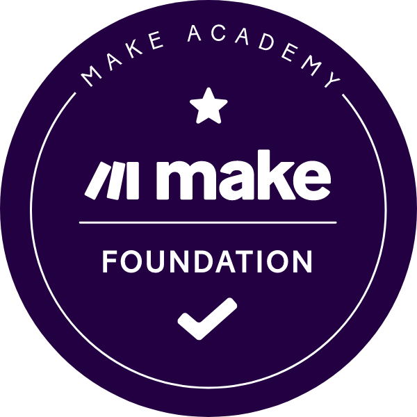

# Hi there, I'm Evangelos Balalas 👋

### Automation Builder & University Student | London, UK 🇬🇧

Focused on building reliable workflow automations, API integrations, and algorithmic trading tools—combining market experience with no-code platforms and AI-assisted Python development.

---

### 🎓 Education

* *Bath Spa University* — Completed Foundation Year; progressing to Level 4

---

### 🏆 Certifications & Verified Badges

* *[Make Foundation Certified](https://credly.com)* — Make Academy (Verified via Credly)  
  Scenario Architecture, Instant Webhooks, Data Mapping, Error Handling, and Operations Optimization.
